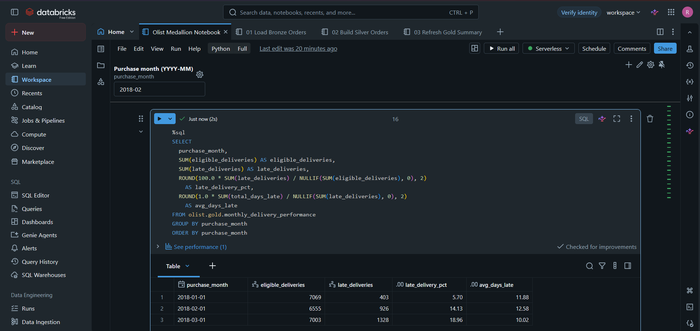
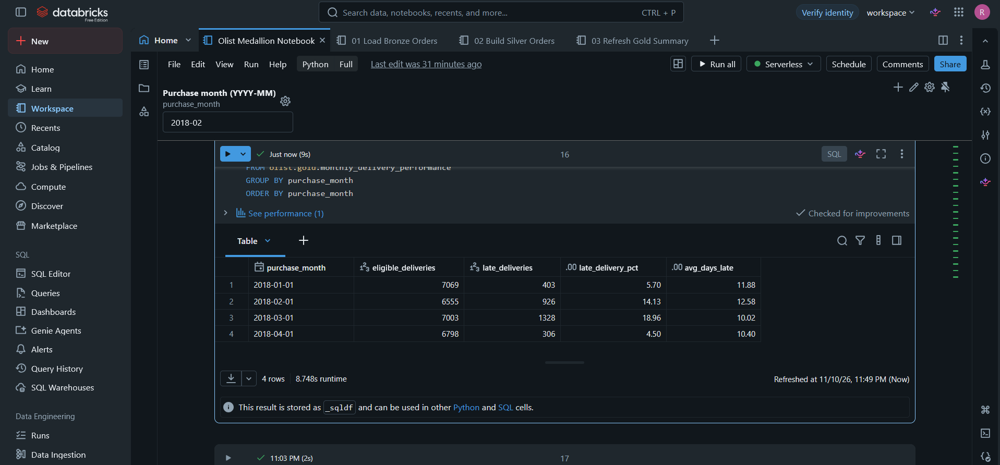

# Simple Olist Databricks Medallion Pipeline

This project demonstrates a simple Bronze, Silver, and Gold pipeline in Databricks Free Edition using Olist orders and customers. A Databricks job loads one purchase month at a time, joins orders to customer records, and refreshes a Gold table for reporting on order volume and late deliveries by customer state. I tested the job by reloading January without double-counting orders and adding April as a new month.

## What the catalog looks like

In Databricks Catalog Explorer, expand the `olist` catalog to see the schemas, source volume, and Delta tables.

```text
olist
├── source                         [schema]
│   └── raw_files                  [managed volume]
│       ├── olist_orders_dataset.csv
│       └── olist_customers_dataset.csv
├── bronze                         [schema]
│   ├── orders                     [Delta table]
│   └── customers                  [Delta table]
├── silver                         [schema]
│   └── orders_enriched            [Delta table]
├── gold                           [schema]
│   └── monthly_delivery_performance  [Delta table]
├── default                        [built-in schema]
└── information_schema             [built-in schema]
```

## How the pipeline works

| Layer | Data | What happens |
| --- | --- | --- |
| Source | `olist.source.raw_files` | A Unity Catalog volume holds the original orders and customers CSVs. |
| Bronze | `olist.bronze.orders`, `olist.bronze.customers` | Orders load one purchase month at a time. The source fields are kept as text, and each order gets a `purchase_month` label. Customers load once as a reference table. |
| Silver | `olist.silver.orders_enriched` | The notebook parses the dates, joins on `customer_id` to add the customer state, and calculates the number of calendar days between the estimated and actual delivery dates. |
| Gold | `olist.gold.monthly_delivery_performance` | One row per purchase month and customer state holds the order counts, delivery counts, and total days late used by the reports. |

This is a historical backfill. The source is a fixed snapshot, and a batch groups orders by when they were placed. An order purchased in January and delivered in February still belongs to the January batch.

Bronze uses Delta Lake's `REPLACE WHERE` to write only the selected month. Silver and Gold rebuild from all loaded batches on each run. With two small source files, a full rebuild keeps the transformation logic straightforward and lets the same job handle a new month or a rerun.

## Follow the data

One Olist order with ID starting `7e257955` was placed on **January 16, 2018**. It was expected on **February 16** and arrived on **February 19**.

| Stage | What happens to this order |
| --- | --- |
| Source | The orders CSV holds the purchase and delivery timestamps. The customers CSV holds the matching customer's state. |
| Bronze | The January load picks up the order and adds `purchase_month = 2018-01-01`. The delivery dates stay as source text. |
| Silver | The join on `customer_id` adds `customer_state = 'AL'` (Alagoas). The date calculation sets `days_vs_estimate = 3`. |
| Gold | The order contributes one placed order, one eligible delivery, one late delivery, and three days late to the January row for `AL`. |

The January state report shows **12 late deliveries out of 36 eligible deliveries** for Alagoas, a late rate of **33.33%**. This order is one of those 12.

## Run the project

### 1. Set up the workspace

1. In a Databricks Free Edition workspace, create the `olist` catalog with default storage. In it, create the `source` schema and a managed volume named `raw_files`.
2. Upload `olist_orders_dataset.csv` and `olist_customers_dataset.csv` from [`data/source/`](data/source/) to `/Volumes/olist/source/raw_files/`.
3. Import the four `.ipynb` files from [`notebooks/`](notebooks/) into your workspace and use Serverless compute.
4. Open [Olist Medallion Notebook](notebooks/Olist%20Medallion%20Notebook.ipynb) and run cells **3, 4, 6, 9, and 12** individually in that order. These create the Bronze schema, seed the orders table with January data, load the customer reference table, and create the Silver and Gold schemas. The other cells record the walkthrough, including manual loads, checks, and reports.

### 2. Configure the job

In **Jobs & Pipelines**, create a job named **Olist Monthly Backfill**. Add these Notebook tasks with **Workspace** as their source and **Serverless** as their compute.

| Task | Notebook | Depends on |
| --- | --- | --- |
| `load_bronze` | [01 Load Bronze Orders](notebooks/01%20Load%20Bronze%20Orders.ipynb) | — |
| `build_silver` | [02 Build Silver Orders](notebooks/02%20Build%20Silver%20Orders.ipynb) | `load_bronze` |
| `refresh_gold` | [03 Refresh Gold Summary](notebooks/03%20Refresh%20Gold%20Summary.ipynb) | `build_silver` |

Add the job parameter `purchase_month` with the default `2018-01`. Run January with **Run now**, then use **Run now with different settings** to run `2018-02` and `2018-03` one at a time. Wait for each run to finish before starting the next because the runs share the same Silver and Gold tables.

### 3. Run the reports

Run cells **15–17** in the walkthrough notebook after the job finishes. Each cell answers a question from the Gold table.

1. How many orders were placed each month, and how many were marked delivered?
2. What share of eligible deliveries arrived late, and how many days late were they on average?
3. Which customer states had the highest late delivery rates for the selected purchase month? Cell 17 starts with January. Change its date filter to inspect another loaded month.

A delivery is eligible if the order is marked `delivered` and has both an actual and an estimated delivery date. A delivery is late if the actual calendar date is after the estimate. The late rate divides late deliveries by eligible deliveries. Average days late divides total days late by the number of late deliveries. Monthly rates use totals across states, so each delivery contributes equally.

## Pipeline verification

The Silver task checks that the table has the same row count as Bronze, every order ID is present and unique, and every order has a customer state. The Gold task checks that each month's order, eligible delivery, and late delivery counts match Silver. Both SQL assertions passed inside the job.

### Reloading January 2018

After I reran the job for January, the Gold report still showed the same three months and the same delivery counts, late rates, and average delays as before the rerun.



### Adding April 2018

I ran the same job with `purchase_month=2018-04`. Bronze loaded 6,939 orders, and April appeared as the fourth month in the Gold report.

| Purchase month | Orders placed | Eligible deliveries | Late deliveries | Late rate | Avg. days late |
| --- | ---: | ---: | ---: | ---: | ---: |
| January 2018 | 7,269 | 7,069 | 403 | 5.70% | 11.88 |
| February 2018 | 6,728 | 6,555 | 926 | 14.13% | 12.58 |
| March 2018 | 7,211 | 7,003 | 1,328 | 18.96% | 10.02 |
| April 2018 | 6,939 | 6,798 | 306 | 4.50% | 10.40 |



## Data attribution

The orders and customers CSVs are from the Brazilian E-Commerce Public Dataset by Olist and are included in their original form. The dataset is licensed under CC BY-NC-SA 4.0. [Olist dataset on Kaggle](https://www.kaggle.com/olistbr/brazilian-ecommerce/home/) · [Dataset license](https://creativecommons.org/licenses/by-nc-sa/4.0/)
